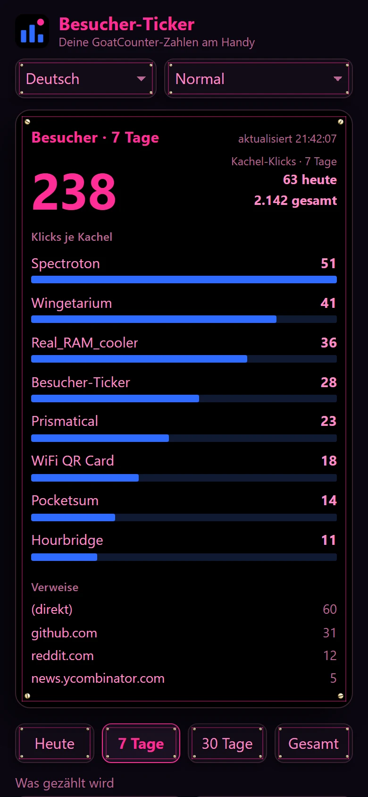

# Besucher-Ticker App

**Deine eigenen GoatCounter-Zahlen am Handy, als installierbare Web-App.** Dieselben Zahlen wie das [Windows-Overlay Besucher-Ticker](https://github.com/Dennismit2n/besucher-ticker): Seitenbesuche oder Kachel-Klicks, für heute, 7 Tage, 30 Tage oder seit Anbeginn, mit Balken je Werkzeug und den Ländern oder Verweisen darunter. Schwarz, pinke Schrift, blaue Balken. Die App selbst zählt nichts.

  

**Live:** https://dennismit2n.github.io/besucher-ticker-app/ · [English version](README.md)

## Was es kann

| | |
|---|---|
| **Drei Zählweisen** | Seitenbesuche (alle Besucher ohne Ereignisse), Kachel-Klicks (nur Ereignisse, deren Pfad mit `kachel-` beginnt, also `kachel-ram` und `kachel-ram-anleitung`, je Werkzeug zusammengefasst und mit dem mitgeschickten Titel beschriftet) oder automatisch: Kachel-Klicks, sobald es je einen gab. |
| **Vier Zeiträume** | Heute, 7 Tage, 30 Tage, Gesamt. Die große Zahl gehört immer zum gewählten Zeitraum, daneben stehen heute und gesamt. |
| **Alle Balken** | 3 bis 20 Balken oder alle. Für „alle“ blättert die App mit `exclude_paths` durch die Liste (höchstens 20 Seiten zu je 100 Pfaden). Auf Wunsch auch Einträge mit 0 aus der Liste seit Anbeginn, und einzeilig, wenn es viele werden. |
| **Länder oder Verweise** | Der Zusatzblock unter den Balken, 3 bis 10 Zeilen. Ein leerer Verweis heißt „(direkt)“: Lesezeichen oder eingetippte Adresse. |
| **Läuft von selbst** | Neue Zahlen alle 15 Sekunden bis 60 Minuten. Im Hintergrund fragt die App nichts ab und holt beim Zurückkommen nach, was fällig ist. Ohne Netz zeigt sie den letzten Stand. |
| **Wie das Overlay** | Drei Farbvarianten, vier Größen, der Beschlag der Werkstatt mit eckigem Rahmen und Schrauben in Weißgold. |

## Zugang und Datenschutz

- Du trägst einmal die Adresse deiner GoatCounter-Seite und ein API-Token ein. Das Token bekommst du bei GoatCounter oben rechts über deinen Benutzernamen, dann „API“ und „Add new token“. Das Recht „Read statistics“ genügt.
- Das Token liegt nur auf deinem Gerät im Speicher dieser App (localStorage) und geht ausschließlich an deine GoatCounter-Seite. Gespeichert wird es erst, wenn GoatCounter es angenommen hat. „Zugang löschen“ in den Einstellungen entfernt es samt dem letzten Stand.
- Es gibt keinen Server dazwischen. GoatCounter erlaubt Abrufe direkt aus dem Browser (CORS), die App spricht nur lesend mit der API.
- Die App zählt nicht mit: kein Tracking, keine Cookies, keine Werbung, keine fremden Skripte oder Schriften. Die Content Security Policy lässt nur Verbindungen über HTTPS zu, weil die Adresse deiner GoatCounter-Seite frei wählbar ist.
- Unabhängiges Werkzeug, nicht von GoatCounter.

## Rücksicht auf GoatCounter

GoatCounter erlaubt 4 Anfragen je Sekunde. Im Browser schickt jede Leseanfrage mit Token vorher eine Vorabfrage (Preflight), die mitzählt. Deshalb liegen zwischen zwei Anfragen mindestens 0,55 Sekunden, doppelt so viel wie im Windows-Overlay. Nach einem Rate-Limit (429) pausiert die App 30, 120 und dann 300 Sekunden, weil der Browser die Wartezeit aus der Antwort nicht lesen darf.

## Installieren und offline

Nach dem ersten Besuch hält ein Service Worker die App auch ohne Verbindung bereit. In Chrome, Edge und Samsung Internet erscheint oben ein Knopf „Installieren“. Auf dem iPhone geht das in Safari über „Zum Home-Bildschirm“.

## Darstellung und Sprachen

Der Ticker bleibt immer dunkel. Dazu hoher Kontrast dunkel und hell, ein Modus für Farbenblinde und umgekehrte Farben, gemeinsam mit den anderen Werkzeugen der Werkstatt. Deutsch, Englisch, Spanisch, Französisch, Italienisch, Niederländisch, Polnisch, Portugiesisch, Türkisch, Russisch, Hindi, Chinesisch, Japanisch und Koreanisch; die Texte des Overlays sind Wort für Wort übernommen. Einige Übersetzungen sind maschinell, Korrekturen nehme ich gern an.

## Entwicklung

Kein Bauschritt, keine Abhängigkeiten.

- `logik.js`: Rechnen und Abrufen, übertragen aus `besucher_ticker.py` 1.4.0 (`auswertenKlicks`, `auswertenHits`, `besucherSeiten`, `zeitfenster`, Blättern, Ratenbremse, ein ganzer Durchlauf).
- `texte.js`: alle Texte in 14 Sprachen. Den Teil aus dem Overlay schreibt `python tools/texte_aus_overlay.py ../besucher-ticker` neu.
- `index.html`: Oberfläche und Stile; `sw.js`: Offline-Hülle.
- `node tests/selbsttest.js`: die Selbsttest-Fälle des Overlays plus die der App, ohne Netz.
- `tools/`: Symbole (Pillow) und Bildschirmfotos (Playwright, mit Beispielzahlen aus `tests/attrappe`); für den Betrieb nicht nötig.

## Lizenz

[MIT](LICENSE)

© 2026 Dennis_mit_2n · Teil der [Werkstatt](https://dennismit2n.github.io/)
