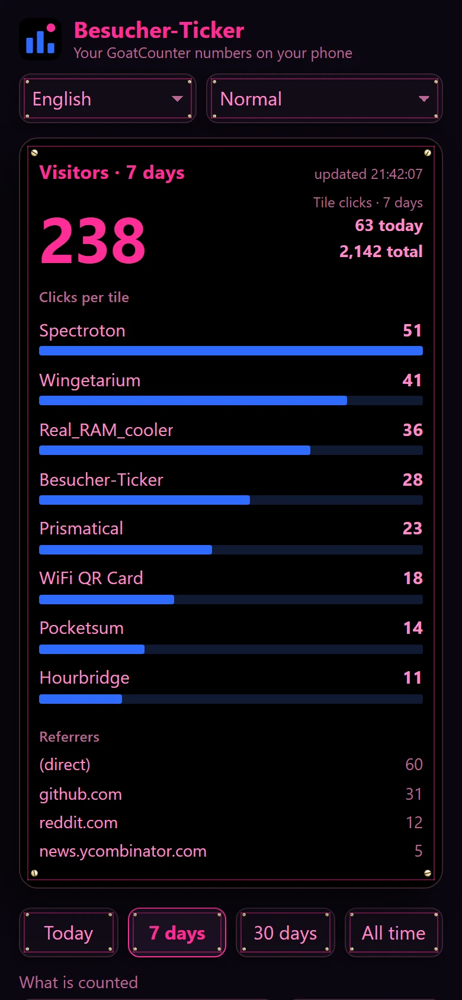

# Besucher-Ticker App

**Your own GoatCounter numbers on your phone, as an installable web app.** The same numbers as the [Besucher-Ticker Windows overlay](https://github.com/Dennismit2n/besucher-ticker): page visits or tile clicks, for today, 7 days, 30 days or all time, with a bar per tool and the countries or referrers below. Black, pink text, blue bars. The app itself counts nothing.

  

**Live:** https://dennismit2n.github.io/besucher-ticker-app/ · [Deutsche Fassung](README.de.md)

## What it does

| | |
|---|---|
| **Three ways of counting** | Page visits (all visitors without events), tile clicks (only events whose path starts with `kachel-`, such as `kachel-ram` and `kachel-ram-anleitung`, grouped per tool and labelled with the title sent along) or automatic: tile clicks as soon as there has ever been one. |
| **Four time ranges** | Today, 7 days, 30 days, all time. The big number always belongs to the chosen range; today and the total sit next to it. |
| **All the bars** | 3 to 20 bars or all of them. For “all” the app pages through the list with `exclude_paths` (at most 20 pages of 100 paths). Optionally also entries with 0 from the all-time list, and one line per bar when there are many. |
| **Countries or referrers** | The extra block below the bars, 3 to 10 rows. An empty referrer is shown as “(direct)”: bookmarks or a typed address. |
| **Runs by itself** | New numbers every 15 seconds up to 60 minutes. In the background the app makes no requests and catches up when you come back. Without a connection it shows the last numbers. |
| **Like the overlay** | Three colour variants, four sizes, the workshop’s fitting with a square frame and white gold screws. |

## Access and privacy

- You enter the address of your GoatCounter site and an API token once. Get the token in GoatCounter via your user name at the top right, then “API” and “Add new token”. The “Read statistics” permission is enough.
- The token stays on your device only, in this app’s storage (localStorage), and is sent to your GoatCounter site and nowhere else. It is stored only after GoatCounter has accepted it. “Remove access” in the settings deletes it together with the last numbers.
- There is no server in between. GoatCounter allows requests straight from the browser (CORS); the app only reads from the API.
- The app counts nothing: no tracking, no cookies, no ads, no third-party scripts or fonts. The Content Security Policy only allows connections over HTTPS, because the address of your GoatCounter site is up to you.
- Independent tool, not made by GoatCounter.

## Being nice to GoatCounter

GoatCounter allows 4 requests per second. In the browser every request with a token is preceded by a preflight, which counts too. So there are at least 0.55 seconds between two requests, twice as much as in the Windows overlay. After a rate limit (429) the app pauses for 30, 120 and then 300 seconds, because the browser is not allowed to read the waiting time from the response.

## Install and offline

After the first visit a service worker keeps the app ready without a connection. Chrome, Edge and Samsung Internet show an “Install” button at the top. On an iPhone use “Add to Home Screen” in Safari.

## Display and languages

The ticker always stays dark. In addition there are high contrast dark and light, a colour-blind mode and inverted colours, shared with the other tools of the workshop. German, English, Spanish, French, Italian, Dutch, Polish, Portuguese, Turkish, Russian, Hindi, Chinese, Japanese and Korean; the overlay’s texts are taken over word for word. Some translations are machine-made, corrections are welcome.

## Development

No build step, no dependencies.

- `logik.js`: counting and fetching, carried over from `besucher_ticker.py` 1.4.0 (`auswertenKlicks`, `auswertenHits`, `besucherSeiten`, `zeitfenster`, paging, rate brake, a whole refresh).
- `texte.js`: all texts in 14 languages. `python tools/texte_aus_overlay.py ../besucher-ticker` rewrites the part taken from the overlay.
- `index.html`: interface and styles; `sw.js`: offline shell.
- `node tests/selbsttest.js`: the overlay’s self-test cases plus the app’s, without network.
- `tools/`: icons (Pillow) and screenshots (Playwright, with sample numbers from `tests/attrappe`); not needed to run the app.

## License

[MIT](LICENSE)

© 2026 Dennis_mit_2n · Part of the [workshop](https://dennismit2n.github.io/)
